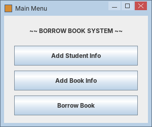
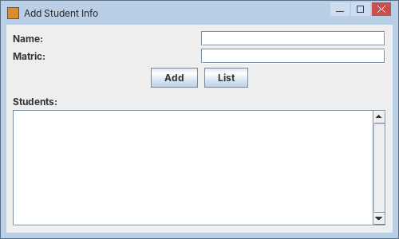
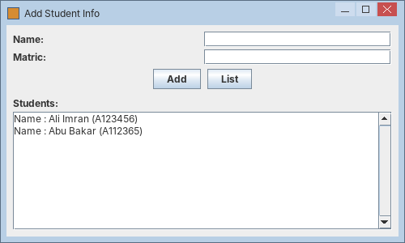
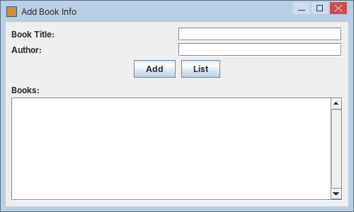
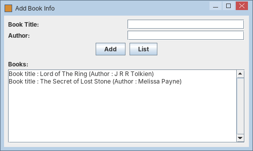
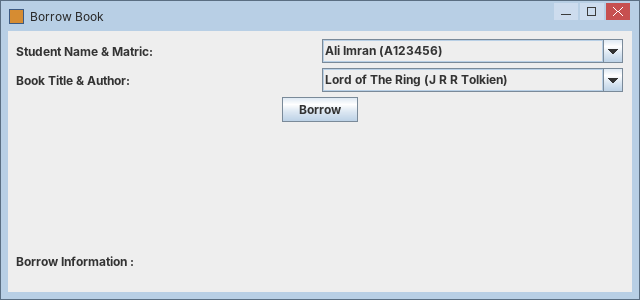
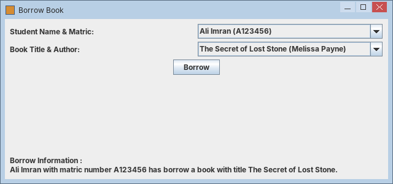

# Borrow Book System

Tutorial 5(a), Section B, Q7 (TK1143 GUI & Event Handling)

## Files

| File | Part | Purpose |
|------|------|---------|
| `MainMenu.java` | (a) | Main menu GUI. **Start here.** |
| `AddStudentInfo.java` | (b) | Add Student Info GUI (Add / List) |
| `AddBookInfo.java` | (c) | Add Book Info GUI (Add / List) |
| `BorrowBook.java` | (d) | Borrow Book GUI (combo boxes + Borrow button) |
| `Student.java` | (e) | Student class (`toString`, `getListInfo`) |
| `Book.java` | (e) | Book class (`borrowBy`, `toString`, `getListInfo`) |
| `LibraryData.java` | - | Shared lists of students and books (2 sample students, 2 sample books) |
| [`screenshots/`](screenshots/) | - | Screenshots of each GUI |

## Screenshots

### Main menu


### Add student information


### Student list


### Add book information


### Book list


### Borrow book


### After borrowing


## How to run (JDK 8 or newer)

```
javac *.java
java MainMenu
```

## Rules used

- One student can borrow only **one** book.
- There is only **one** copy of each book title.
